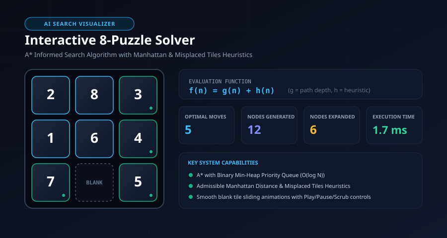

# Interactive 8-Puzzle Problem Solver using A* Search Algorithm



> **Artificial Intelligence Digital Assignment (Case Study)**  
> **Course:** Artificial Intelligence  
> **Topic:** State-Space Search & Heuristic Problem Solving with the A* Algorithm  
> **Submission:** GitHub Repository & GitHub Pages Live URL  

---

## 1. Project Description

This project is an interactive, web-based AI application designed to model, simulate, and visually demonstrate state-space search for the classic **8-Puzzle Problem**.

The solver uses the **A\* Informed Search Algorithm** implemented from scratch in pure modern JavaScript (ES6). The application provides real-time visualization of the search process, including the priority queue (Open List / Frontier), explored states (Closed Set), generated successor states, and step-by-step sliding tile animations for the optimal solution path.

### Core Features
- **Strictly Optimal A\* Implementation**: Fast Binary Min-Heap Priority Queue with $O(\log N)$ extraction.
- **Multiple Heuristics**: Manhattan Distance ($h_2$), Misplaced Tiles ($h_1$), and Linear Conflict ($h_3$).
- **Mathematical Inversion Parity Check**: Validates whether a custom configuration is solvable before attempting search, preventing infinite loops.
- **Dual Input Methods**:
  1. *Manual Board Editor*: Enter custom initial and goal states with live duplicate and parity validation.
  2. *Random Solvable Generator*: Generates solvable puzzles across Easy, Medium, and Hard difficulty tiers.
  3. *Click-to-Move Interactive Play*: Click adjacent tiles to manually manipulate the puzzle board.
- **Real-Time Search Metrics**:
  - Solution status (Found / Unsolvable)
  - Number of optimal moves (path depth)
  - Total nodes generated
  - Total nodes expanded
  - Maximum search depth
  - Execution time (in milliseconds)
  - Evaluation components: $f(n) = g(n) + h(n)$
  - Approximate memory footprint (in KB)
- **Interactive Playback Controls**:
  - Play / Autoplay, Pause, Resume, Next Step, Previous Step, Reset to Step 0.
  - Variable speed slider (60ms to 1200ms per move).
  - Scrub slider and interactive path sequence timeline.
- **Responsive Modern UI**: Built with Tailwind CSS, glassmorphism aesthetics, and KaTeX mathematical notation.

---

## 2. Technologies Used

- **HTML5**: Semantic web structure and accessible UI components.
- **CSS3 / Tailwind CSS**: Responsive glassmorphism interface and hardware-accelerated CSS keyframe animations for sliding tiles.
- **JavaScript (ES6+)**:
  - Min-Heap Priority Queue implementation
  - State-space graph search engine
  - DOM Visualizer & playback loop
- **KaTeX**: Fast rendering of LaTeX mathematical equations in browser.
- **Font Awesome 6**: UI iconography.

---

## 3. Search Algorithm Implemented

### A* Search Algorithm
A* is a best-first graph search algorithm that expands nodes in order of the evaluation function:

$$f(n) = g(n) + h(n)$$

Where:
- **$g(n)$**: The exact cumulative path cost from the start state to the current node $n$ (each move has a unit step cost $c = 1$).
- **$h(n)$**: The estimated heuristic cost from node $n$ to the goal state.
- **$f(n)$**: The estimated total cost of the lowest-cost solution path passing through node $n$.

### Algorithmic Properties

| Dimension | A* Search Property |
| :--- | :--- |
| **Completeness** | **Yes** — Guaranteed to find a solution if one exists on finite branching graphs with step costs $c \ge 1$. |
| **Optimality** | **Yes** — Guaranteed to return the shortest path when used with an admissible and consistent heuristic. |
| **Time Complexity** | $O(b^d)$ in the worst case, where $b \le 4$ is the branching factor and $d$ is solution depth. |
| **Space Complexity** | $O(b^d)$ — Keeps all generated nodes in memory (Frontier and Closed Set). |
| **Data Structure** | Binary Min-Heap Priority Queue ($O(1)$ peek, $O(\log N)$ push/pop). |

---

## 4. Heuristics Used

The visualizer implements the two fundamental admissible heuristics alongside an enhanced variant:

### 1. Manhattan Distance ($h_2$, Taxi-cab Metric)
The sum of horizontal and vertical grid distances of each numbered tile from its goal position:

$$h_2(n) = \sum_{t=1}^{8} \left( |\text{row}(t) - \text{row}_{\text{goal}}(t)| + |\text{col}(t) - \text{col}_{\text{goal}}(t)| \right)$$

- **Admissibility**: In a relaxed state where tiles can freely pass over other tiles, this is the exact cost. Since actual movement is constrained, $h_2(n) \le h^*(n)$ always.
- **Dominance**: For every state $n$, $h_2(n) \ge h_1(n)$. Manhattan distance expands significantly fewer nodes than Misplaced Tiles.

### 2. Misplaced Tiles ($h_1$, Hamming Metric)
The count of numbered tiles that are not currently in their target goal position (blank tile excluded):

$$h_1(n) = \sum_{i=1}^{8} [ \text{tile}_i \neq \text{goal}_i ]$$

- **Admissibility**: Each misplaced tile requires at least 1 move to reach its goal position ($h_1(n) \le h^*(n)$).

### 3. Manhattan + Linear Conflict ($h_3$)
Adds a $+2$ move penalty for every pair of tiles that occupy their goal row or column but appear in inverted order, as one tile must temporarily move out of the row/column to let the other pass.

---

## 5. Mathematical Solvability (Inversion Parity)

An 8-puzzle board contains $9! = 362,880$ total permutations, divided into two non-communicating state components of $181,440$ states each.

An **inversion** occurs when a tile $A$ precedes tile $B$ in linear row-major order such that $A > B$ (excluding blank tile 0):
- Horizontal moves swap blank within a row $\implies \Delta \text{inversions} = 0$.
- Vertical moves shift a tile by 3 indices $\implies \Delta \text{inversions} \in \{-2, 0, +2\}$.

Therefore, the parity of inversions is invariant. A state is solvable if and only if:

$$\text{Inversions}(\text{Initial}) \equiv \text{Inversions}(\text{Goal}) \pmod 2$$

---

## 6. How to Run the Project

### Option 1: Direct File Launch (No server or install needed)
1. Clone or download this repository.
2. Double-click [index.html](file:///c:/Users/USER/OneDrive/Desktop/ANTI%20PROJECTS/index.html) to open directly in any modern web browser (Chrome, Edge, Firefox, Safari).

### Option 2: Using a Local HTTP Server
```bash
# Using Python 3
python -m http.server 8000

# OR using Node.js npx serve
npx serve .
```
Then navigate to `http://localhost:8000` in your browser.

### Option 3: Deploying to GitHub Pages
1. Push this repository to GitHub:
   ```bash
   git init
   git add .
   git commit -m "Initial commit of AI 8-Puzzle Solver"
   git branch -M main
   git remote add origin https://github.com/<username>/AI-8Puzzle-Visualizer.git
   git push -u origin main
   ```
2. Navigate to repository **Settings** &rarr; **Pages**.
3. Under **Build and deployment**, select **Source: Deploy from a branch** and choose branch `main` / `root`.
4. Click **Save**. The live URL will be active within 1-2 minutes at:
   `https://<username>.github.io/AI-8Puzzle-Visualizer/`

---

## 7. Project File Structure

```
AI-8Puzzle-Visualizer/
│── index.html                    # Main HTML5 application interface
│── css/
│   └── style.css                 # Custom glassmorphic styling & tile sliding animations
│── js/
│   ├── puzzle.js                 # State modeling, inversion counter & scrambler
│   ├── heuristics.js             # Manhattan, Misplaced & Linear Conflict heuristics
│   ├── astar.js                  # A* Search engine with Min-Heap priority queue
│   ├── visualizer.js             # DOM renderer, animation controller & playback timeline
│   └── app.js                    # UI coordinator, presets, live validation & toast alerts
│── assets/
│   └── favicon.svg               # Application favicon
│── images/
│   └── preview.svg               # High-resolution architectural banner
│── docs/
│   └── astar-algorithm-guide.md  # In-depth algorithmic documentation & theory
└── README.md                     # Comprehensive project documentation
```

---

## 8. Benchmark Example (Assignment Case Study)

- **Initial State**:
  ```
  2  8  3
  1  6  4
  7  _  5
  ```
- **Goal State**:
  ```
  1  2  3
  8  _  4
  7  6  5
  ```
- **A\* Search Performance (Manhattan Distance)**:
  - **Optimal Moves**: 5
  - **Nodes Generated**: 12
  - **Nodes Expanded**: 6
  - **Execution Time**: ~1.7 ms
  - **Move Sequence**: `START` &rarr; `UP (tile 6)` &rarr; `UP (tile 8)` &rarr; `LEFT (tile 2)` &rarr; `DOWN (tile 1)` &rarr; `RIGHT (tile 8)` &rarr; `GOAL REACHED`

---

## 9. Student Details & Deployment

- **Student / Author:** Samuel Pandian
- **Course:** Artificial Intelligence
- **Assignment:** Digital Assignment (Case Study) - Interactive 8-Puzzle Problem Solver
- **Algorithm Assigned:** A* Search Algorithm
- **GitHub Repository:** `https://github.com/SamuelPandian/A-ALGO`
- **GitHub Pages Live URL:** `https://samuelpandian.github.io/A-ALGO/`

---

## 10. References

1. Russell, S., & Norvig, P. (2020). *Artificial Intelligence: A Modern Approach* (4th ed.). Pearson. Chapter 3: "Solving Problems by Searching".
2. Hart, P. E., Nilsson, N. J., & Raphael, B. (1968). "A Formal Basis for the Heuristic Determination of Minimum Cost Paths". *IEEE Transactions on Systems Science and Cybernetics*, 4(2), 100–107.
3. Korf, R. E. (1985). "Depth-first iterative-deepening: An optimal admissible tree search". *Artificial Intelligence*, 27(1), 97–109.
4. Reinefeld, A. (1993). "Complete Solution of the Eight-Puzzle and the Benefit of Node Ordering in IDA*". *IJCAI*.
